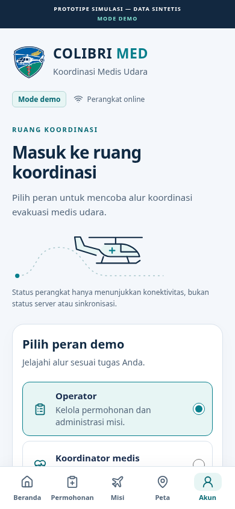
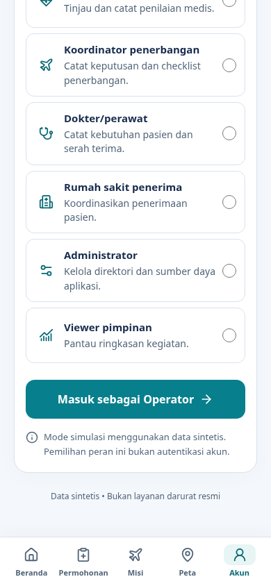
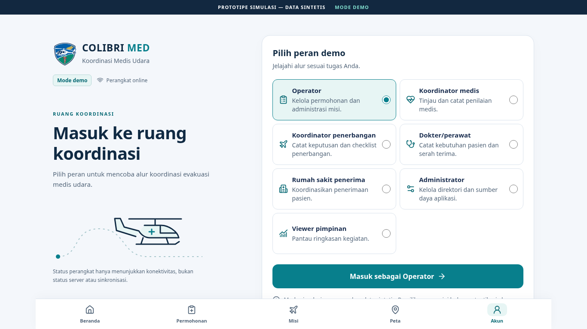
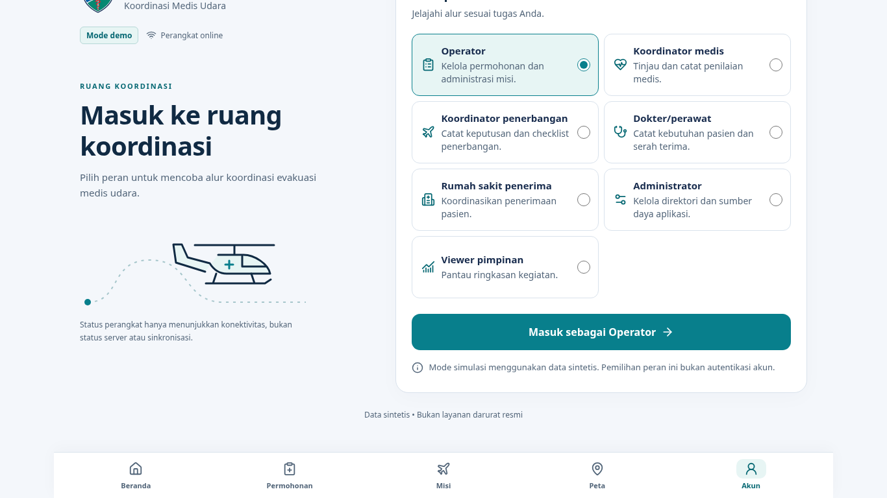

# Redesign login demo mobile

Catatan ini mendokumentasikan perubahan login awal. Lihat [desain pengalaman mobile](MOBILE-EXPERIENCE-DESIGN.md) untuk cakupan seluruh halaman dan hasil regresi terbaru.

Halaman `/mobile/login` menggunakan identitas medis udara, kartu peran radio native, tombol dinamis, ilustrasi helikopter generik lokal, dan layout dua panel mulai 700px. Grid peran menjadi dua kolom mulai 1100px. Logo asli dipertahankan; ilustrasi tidak mengklaim akurasi model Colibri.

## Audit dan batas perubahan

- React/TypeScript, Vite, Lucide, serta font sistem yang sudah tersedia; tanpa dependensi baru.
- Tujuh nilai `Role`, ID `demo:<role>`, sesi `sessionStorage` satu jam, `mobileDestination`, dan pemulihan tujuan tetap sama. Tidak ada kredensial atau preferensi baru yang disimpan.
- Login demo mobile berjalan sinkron, tanpa loading atau delay buatan. Form connected, login desktop/admin/pimpinan, API, dan model otorisasi dipertahankan.
- Copy peran disesuaikan dengan matriks `ACCESS-AND-API.md`: Administrator mengelola direktori/sumber daya; koordinator medis mencatat penilaian; koordinator penerbangan mencatat keputusan/checklist.
- `navigator.onLine` hanya menjelaskan konektivitas perangkat. Teks tidak mengklaim status server, sinkronisasi, atau kesiapan medis.
- Token dan selector CSS dicakup pada login demo mobile. Layout mobile mengukur tinggi navigasi dengan ResizeObserver untuk menyediakan ruang scroll, termasuk ketika teks membesar. Lima tautan dan penentuan tab aktif tetap sama.

## File implementasi

- `src/pages/MobileDemoLogin.tsx`: presentasi, radio native, ilustrasi SVG, status perangkat, dan aksi demo.
- `src/pages/mobile-login.css`: token, layout responsif, focus, safe area, dan reduced motion.
- `src/pages/Login.tsx`: memilih presentasi demo mobile dan meneruskan sesi/tujuan yang sama.
- `src/pages/Mobile.tsx`: menampilkan identitas login tanpa duplikasi header, menyediakan ruang navigasi.
- `src/main.tsx`: class layout khusus rute login demo mobile.
- `e2e/mobile-login.spec.ts`: cakupan interaksi, viewport, keyboard, dan aksesibilitas.
- `e2e/mobile.spec.ts`, `e2e/mobile-functional.spec.ts`: locator diperbarui untuk radio/tombol baru; assertion alur tetap dipertahankan.

## Verifikasi

- 69 unit/mock tests lulus.
- TypeScript, Vite production build, dan pemindaian marker konfigurasi server lulus. Warning Zod/chunk besar yang sudah ada tetap muncul.
- 14 tes login baru lulus: 320×568, 360×800, 390×844, 430×932, 768×1024, 1366×768; semua tujuh peran, label tombol, sesi/reload, keyboard/focus, offline/online, teks diperbesar 200%, dan reduced motion.
- Regresi penuh: 37/38 lulus. `e2e/workflow.spec.ts:2` gagal pada timestamp polling halaman internal saat hidden. Ini kegagalan intermiten yang juga ditemukan sebelum redesign saat onboarding; tidak diubah atau dinonaktifkan. Run sebelumnya setelah redesign lulus pada tes tersebut.
- Tidak ada overflow horizontal pada enam viewport. Footer/action dapat di-scroll di atas navigasi, termasuk layar pendek.
- Prettier pada file yang diubah dan `git diff --check` lulus.
- Kontras teks yang digunakan: teks utama/putih 14.10:1; sekunder/putih 6.01:1; sekunder/teal lembut 5.37:1; sekunder/latar 5.59:1; tombol putih/teal 4.75:1; hover 6.49:1; badge 5.80:1; judul/latar 13.63:1; error/putih 6.57:1.

## Screenshot yang ditinjau

Screenshot Chromium pada 390×844 dan 1366×768, sebelum dan setelah scroll. Halaman sengaja dapat di-scroll; konten tidak diperkecil untuk memuat semua peran sekaligus.

| Mobile: identitas                                       | Mobile: aksi setelah scroll                               |
| ------------------------------------------------------- | --------------------------------------------------------- |
|  |  |

Belum diuji: perangkat iOS/Android fisik, VoiceOver/TalkBack, deployment remote dan integrasi Google Sheets/Vercel nyata. Tidak ada deploy/publish yang dilakukan.
